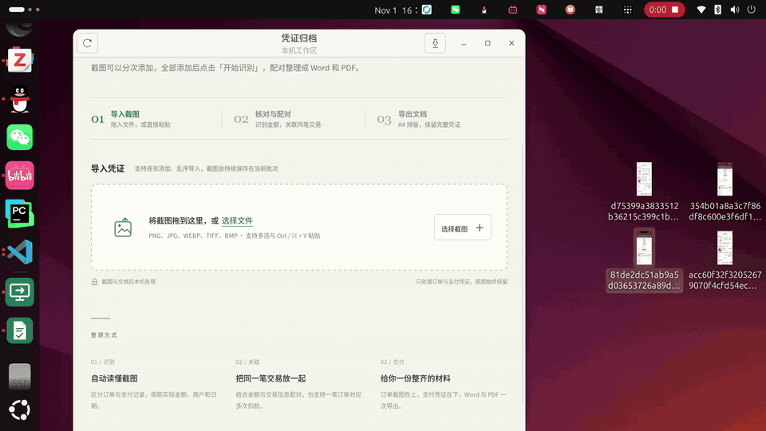

# Receipt Archive

Turn **order screenshots** and **payment screenshots** into a printable reimbursement packet.

Offline OCR · Local-only · Automatic matching · Word / PDF export

[中文说明](README.md) · [Full guide](docs/guide.en.md) · [Download](https://github.com/ZzxArthur/receipt-archive/releases)

## Demo

[Watch the full video](docs/assets/demo.mp4)

## What it does

- **Import in any order.** Drag and drop, choose files, or paste screenshots. Identical images are skipped automatically.
- **Recognize locally.** Extract the actual paid amount, transaction date, merchant, and order number from Chinese order/payment pages.
- **Match conservatively.** Pair orders with payments, including up to four split payments; ambiguous combinations need review.
- **Correct and continue.** Edit fields and pairings manually. Batches survive closing the window.
- **Export A4 Word / PDF.** Place each order above its payment receipts, with optional cropping of promotional footers.

This is a **reimbursement evidence organizer**. It does not issue invoices, verify tax records, or perform bookkeeping.

## Install

Download a package from [Releases](https://github.com/ZzxArthur/receipt-archive/releases).

| Platform | Package | Open it |
| --- | --- | --- |
| Ubuntu 20.04 / 22.04 / 24.04 LTS, x86_64 | `.deb` | Install with `sudo apt install ./receipt-archive_1.3.1_amd64.deb`, then open Receipt Archive from the app menu. |
| Windows 10 / 11, x64 | Portable `.zip` | Extract the whole archive, then double-click `run.vbs`. |

Ubuntu requires GTK 3 / WebKitGTK 2.36+; apt handles these dependencies. Windows requires the Microsoft Visual C++ v14 x64 Runtime.

The Windows package is cross-built and has not completed native Windows regression testing.

For source installation or package builds, see the [full guide](docs/guide.en.md#quick-start). Binary packages are not committed to Git.

## Use it

1. **Import** order and payment screenshots. You can add them in several rounds.
2. **Recognize** with “开始识别” (Start recognition).
3. **Review** the extracted fields under “识别结果” (Results), especially the actual paid amount.
4. **Pair** under “配对预览” (Pairs). Check yellow groups and adjust pairings manually when needed.
5. **Export** Word, PDF, or both. Export before clearing the batch for your next project.

Clearing a batch deletes its saved screenshots and recognition results. Keep important source images separately.

## Offline and private

OCR, matching, and document export run on your computer. No cloud OCR, accounts, API keys, or telemetry.

Release packages bundle their OCR models. A first source installation needs network access for dependencies and models; normal use runs offline.

Data stays in `~/.local/share/receipt-archive/data/` on Ubuntu or `%LOCALAPPDATA%\ReceiptArchive\data\` on Windows. Copy that folder to back up your work.

## Limits

- Chinese order/payment screenshots are the main supported input. PNG, JPEG, WEBP, TIFF, and BMP are accepted; PDF / OFD / XML invoices are not.
- A batch allows **500 images**, **20 MB per image**, **512 MB total**. One batch is active at a time.
- OCR can misread compressed or unusual layouts. Review amounts before exporting.
- Automatic matching requires an exact amount and a unique combination. One payment covering several orders is not supported.
- The OCR engine is pinned to the pre-release `RapidOCRLite==5.0.0a15`. Test your samples before upgrading.

See the [full limitations and workarounds](docs/guide.en.md#limitations).

## Contribute

Setup, tests, and design constraints are in the [contribution guide](CONTRIBUTING.md) and [full guide](docs/guide.en.md#development). Report security issues as described in [SECURITY.md](SECURITY.md).

## License

Code: [MIT](LICENSE). OCR: [RapidOCRLite](https://github.com/RapidAI/RapidOCRLite); PaddleOCR-derived model weights carry Apache-2.0 attribution in `receipt_tool/models/`.
