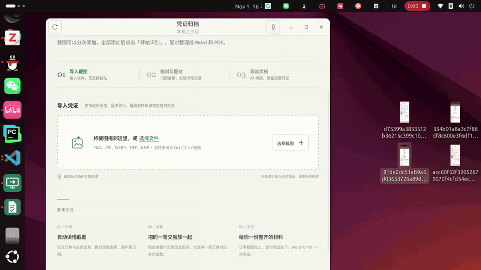

# 凭证归档 · Receipt Archive

把**订单截图和支付截图**整理成可打印、可提交的报销材料。

离线 OCR · 本机处理 · 自动配对 · 导出 Word / PDF

[](LICENSE)


[](https://github.com/ZzxArthur/receipt-archive/actions/workflows/ci.yml)

[下载安装](#下载安装) · [使用方法](#使用方法) · [完整指南](docs/guide.zh-CN.md) · [English](README.en.md)

## 演示

拖入截图 → 离线识别与配对 → 导出 Word / PDF。

[](docs/assets/demo.mp4)

[观看完整录屏（约 27 秒）](docs/assets/demo.mp4)

## 能做什么

- 拖拽、选图或粘贴导入，支持分次添加与重复图片去重。
- 离线识别类型、实付金额、日期、商户和订单号，截图保存在本机。
- 自动关联订单与支付凭证；支持最多 4 张分笔支付，歧义配对交给人工核对。
- 支持字段修改和手动配对，重新打开可继续上次批次。
- 按 A4 排版导出 DOCX / PDF，订单在上、支付凭证在下。

## 下载安装

从 [Releases](https://github.com/ZzxArthur/receipt-archive/releases/latest) 下载对应平台的 **1.3.1** 安装包：

| 平台 | 安装方式 |
| --- | --- |
| Ubuntu 20.04 / 22.04 / 24.04 LTS（x86_64） | 下载 `receipt-archive_1.3.1_amd64.deb`，执行下方命令，再从应用菜单打开 |
| Windows 10 / 11（x64） | 下载 `receipt-archive_1.3.1_windows_x64.zip`，完整解压后双击 `run.vbs` |

```bash
sudo apt install ./receipt-archive_1.3.1_amd64.deb
```

Ubuntu 所需的 GTK / WebKitGTK 依赖由 apt 处理。Windows 需要 [Microsoft Visual C++ v14 x64 Runtime](https://learn.microsoft.com/cpp/windows/latest-supported-vc-redist)。

需要从源码运行或自行打包？见[完整指南](docs/guide.zh-CN.md#快速开始)。

## 使用方法

1. **导入**：把订单页和支付页混合拖入，或选图、粘贴。
2. **识别**：添加完成后点击「开始识别」。
3. **核对**：确认类型、实付金额及配对关系，必要时手动调整。
4. **导出**：选择 Word、PDF 或两者打包；一笔订单独立分页。

开始下一批前先导出，再点击「清空本批次」。清空会删除当前批次的截图与识别结果，已导出的文件保留。

## 使用范围与数据

- 主要面向中文订单／支付截图，支持 PNG、JPEG、WEBP、TIFF、BMP；不解析 PDF / OFD / XML 电子发票，也不做发票查验或记账。
- OCR 结果需要核对；金额必须精确相等且组合唯一，才会自动确认配对。
- 单批最多 **500 张、单张 20 MB、合计 512 MB**。
- 安装包内置模型，日常使用无需联网或 API Key。数据默认保存在下列目录，复制整个 `data` 目录即可备份。

| 平台 | 数据目录 |
| --- | --- |
| Ubuntu | `~/.local/share/receipt-archive/data/` |
| Windows | `%LOCALAPPDATA%\ReceiptArchive\data\` |

OCR 引擎固定为预发布版 `RapidOCRLite==5.0.0a15`；Windows 包由 Linux 交叉构建，尚未完成 Windows 实机回归。更多限制和常见问题见[完整指南](docs/guide.zh-CN.md#局限性)。

## 参与项目

[贡献指南](CONTRIBUTING.md) · [更新记录](CHANGELOG.md) · [安全问题](SECURITY.md)

代码采用 [MIT License](LICENSE)。OCR 使用 [RapidOCRLite](https://github.com/RapidAI/RapidOCRLite)，模型源自 PaddleOCR；第三方来源与许可见[模型说明](receipt_tool/models/NOTICE.txt)。
